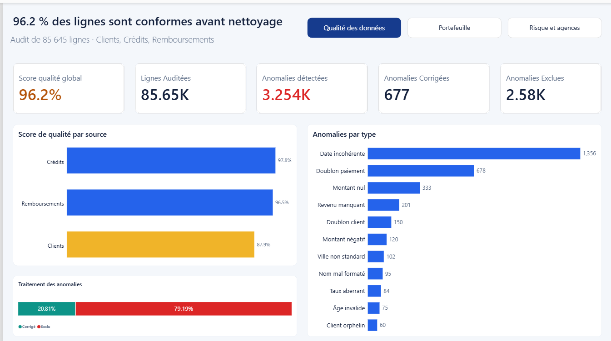
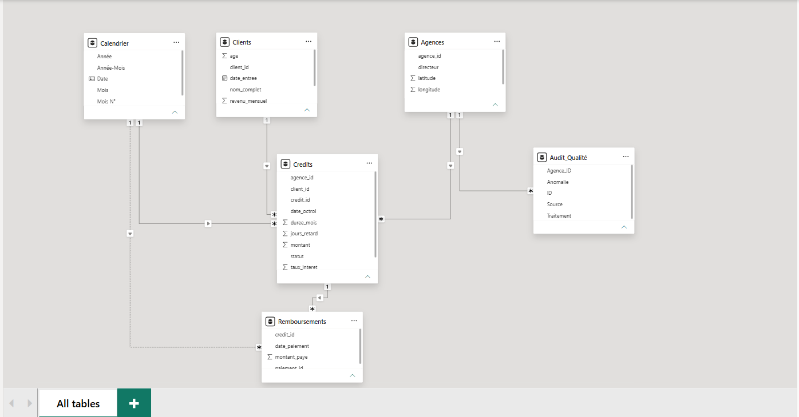
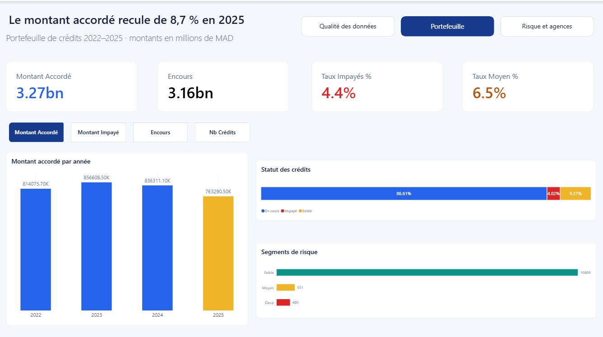
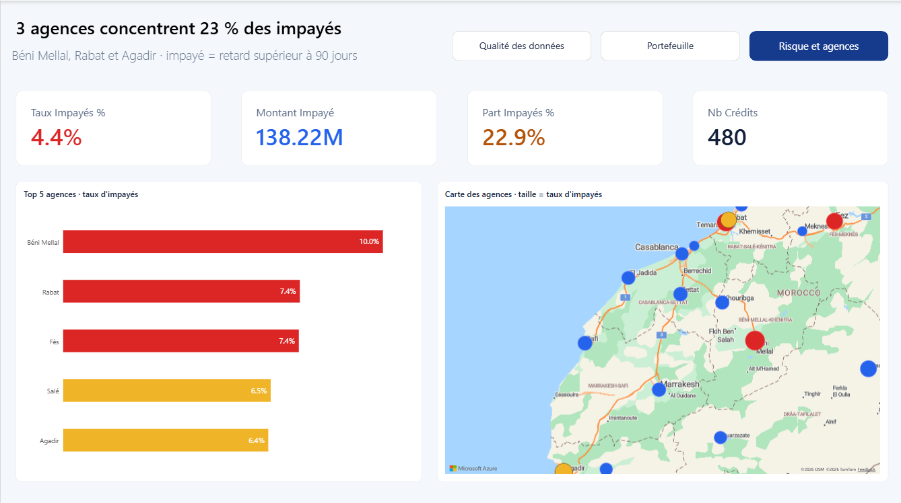

# Bank Data Quality & Credit Portfolio Monitoring

**Power BI · Power Query · DAX · Python** — Un dashboard qui mesure la qualité des données d’une banque, puis pilote son portefeuille de crédits à partir de données fiabilisées.

> *End-to-end Power BI project: Python data generation → Power Query cleaning → star schema → DAX → 3-page dashboard with drill-through and row-level security.*




> **Données 100 % fictives.** Le jeu de données est généré par un script Python (`generer_donnees.py`) avec des erreurs injectées volontairement. Il ne contient aucune donnée réelle ni confidentielle.

---

## 1. Contexte et problème

Une banque fictive reçoit des données clients, crédits et remboursements issues de 25 agences. Ces données contiennent des erreurs (doublons, valeurs manquantes, dates incohérentes, montants négatifs…) qui faussent le suivi du risque.

**Objectif :** (1) mesurer et documenter la qualité des données, (2) corriger ce qui peut l’être, (3) piloter le portefeuille de crédits et le risque d’impayés par agence.

## 2. Résultats clés

| Indicateur | Valeur |
|---|---|
| Lignes auditées | **85 645** |
| Anomalies détectées | **3 254** (677 corrigées · 2 577 exclues) |
| Score de qualité global avant nettoyage | **96,2 %** |
| Score par source | Clients **87,9 %** · Crédits **97,8 %** · Remboursements **96,5 %** |
| Montant accordé (2022–2025) | **3,27 Md MAD** |
| Encours | **3,16 Md MAD** |
| Taux d’impayés (retard > 90 jours) | **4,4 %** |
| Évolution du montant accordé | 2023 **+5,2 %** · 2024 **−2,4 %** · 2025 **−8,7 %** |

**Ce que montre l’analyse :**
- 1 client sur 8 avait au moins une donnée à corriger (87,9 % de conformité).
- Les **3 agences les plus exposées** (Béni Mellal, Rabat, Agadir) portent **22,9 %** du montant impayé.
- **Béni Mellal** a le taux d’impayés le plus élevé du réseau : **10,0 %**, soit plus de deux fois la moyenne.
- 480 crédits sont classés à risque élevé (retard > 90 jours).

## 3. Architecture

```
generer_donnees.py ──► CSV (4 tables)
        │
        ▼
Power Query : détection des anomalies ──► nettoyage ──► table d’audit
        │
        ▼
Modèle en étoile (Calendrier · Agences · Clients → Crédits → Remboursements)
        │
        ▼
Mesures DAX ──► Dashboard 3 pages + drill-through + RLS
```

## 4. Les données

| Table | Lignes | Rôle |
|---|---|---|
| `agences.csv` | 25 | Dimension : ville, région, coordonnées, directeur |
| `clients.csv` | 5 150 | Dimension : âge, ville, segment, revenu |
| `credits.csv` | 12 000 | Fait : montant, taux, durée, statut, jours de retard |
| `remboursements.csv` | 68 495 | Fait : paiements par crédit |
| `Calendrier` | 1 461 jours | Créée en DAX (2022–2025) |

**Erreurs injectées volontairement :**

| Table | Erreur | Nombre |
|---|---|---|
| Clients | Doublons | 150 |
| Clients | Revenu manquant | 201 |
| Clients | Âge impossible | 75 |
| Clients | Ville non standard | 102 |
| Clients | Nom mal formaté | 95 |
| Crédits | Montant négatif | 120 |
| Crédits | Taux aberrant | 84 |
| Crédits | Client inexistant | 60 |
| Remboursements | Date avant l’octroi du crédit | 1 356 |
| Remboursements | Doublons | 678 |
| Remboursements | Montant nul | 333 |

## 5. Nettoyage avec Power Query

Principe : on **détecte d’abord** les anomalies sur les données brutes (colonne `Anomalie`), ce qui alimente la table `Audit_Qualité`, puis on **corrige ou exclut**.

| Anomalie | Traitement | Justification |
|---|---|---|
| Doublon (client, paiement) | Exclu | Clé de dédoublonnage : nom normalisé + date + segment + ville |
| Âge invalide | Corrigé (vide) | Valeur impossible, on ne l’invente pas |
| Revenu manquant | Corrigé | Remplacé par la médiane du segment |
| Ville non standard | Corrigé | Fonction `fnVilleStd` (casse, espaces, alias) |
| Montant négatif | Corrigé | Valeur absolue (erreur de signe) |
| Taux aberrant | Corrigé (vide) | Hors de l’intervalle ]0 ; 20] % |
| Client inexistant | Exclu | Intégrité référentielle |
| Date de paiement avant l’octroi | Exclu | Incohérence temporelle |
| Montant de paiement nul | Exclu | Paiement non exploitable |

Les chemins de fichiers passent par un **paramètre** (`CheminDossier`), et les requêtes techniques ne sont pas chargées dans le modèle.

## 6. Modèle de données

Schéma en étoile : `Crédits` au centre, filtré par `Agences`, `Clients` et `Calendrier` ; `Remboursements` filtré via `Crédits`.

- Relations **1 → \*** avec filtre dans un seul sens.
- Relation `Calendrier[Date]` → `Remboursements[date_paiement]` **inactive**, activée à la demande avec `USERELATIONSHIP`.
- Table `Audit_Qualité` reliée à `Agences`.
- Table de mesures dédiée (`_Mesures`), colonnes techniques masquées.



## 7. Mesures DAX principales

```dax
Encours = CALCULATE ( [Montant Accordé], Credits[statut] <> "Soldé" )

Taux Impayés % = DIVIDE ( [Montant Impayé], [Encours] )

Variation YoY % =
DIVIDE ( [Montant Accordé] - [Montant Accordé N-1], [Montant Accordé N-1] )

Part Impayés % =
DIVIDE ( [Montant Impayé], CALCULATE ( [Montant Impayé], ALL ( Agences ) ) )

Score Qualité % =
DIVIDE ( [Lignes Auditées] - [Nb Anomalies], [Lignes Auditées] )

Remboursé par Date de Paiement =
CALCULATE (
    [Total Remboursé],
    USERELATIONSHIP ( Calendrier[Date], Remboursements[date_paiement] ),
    CROSSFILTER ( Calendrier[Date], Credits[date_octroi], NONE )
)
```

Autres éléments : paramètre de champ `Indicateur` (bascule entre montant, encours, impayé, nombre de crédits), colonne calculée `Segment Risque` (faible / moyen / élevé), classement des agences avec `RANKX`.

## 8. Le dashboard

| Page | Message | Contenu |
|---|---|---|
| **1 · Qualité des données** | 96,2 % des lignes sont conformes avant nettoyage | Score par source, anomalies par type, corrigées vs exclues |
| **2 · Portefeuille** | Le montant accordé recule de 8,7 % en 2025 | KPI, évolution annuelle avec YoY, statut des crédits, segments de risque |
| **3 · Risque et agences** | 3 agences concentrent 23 % des impayés | Top 5 agences, carte, KPI de risque |
| **Détail agence** (drill-through) | — | Fiche d’une agence : KPI, évolution, répartition par type, top 10 des crédits en retard |





**Design :** thème personnalisé *Daylight Finance* (`Daylight_Finance_theme.json`), police Segoe UI, grille de 1280 × 720 px, titres qui énoncent le message.

## 9. Sécurité par agence (Row-Level Security)

Un rôle `Directeur_Agence` filtre les données selon l’email de l’utilisateur, à partir d’une table d’accès :

```dax
CONTAINS ( Acces, Acces[Email], USERPRINCIPALNAME (), Acces[agence_id], Agences[agence_id] )
```

Le filtre se propage de `Agences` vers `Crédits`, `Remboursements` et `Audit_Qualité`. Testé dans Power BI Desktop avec **View as**.

## 10. Définitions et hypothèses

- **Impayé** : crédit en retard de plus de 90 jours.
- **Encours** : montant des crédits non soldés (en cours ou impayés). Définition simplifiée : le capital restant dû n’est pas calculé.
- **Score de qualité** : part des lignes sans anomalie sur l’ensemble des lignes auditées ; une ligne n’est comptée que pour sa première anomalie.
- Montants en dirhams (MAD).

## 11. Limites

- Données fictives : les résultats illustrent la méthode, pas une réalité bancaire.
- Le projet n’est pas publié dans Power BI Service : pas d’actualisation planifiée.
- La table `Clients` n’est pas filtrée par la RLS : elle n’est jamais affichée en détail dans le rapport.
- Une ligne en anomalie n’est étiquetée qu’avec sa première règle (priorité définie dans le code).

## 12. Structure du dépôt

```
bank-data-quality-powerbi/
├── README.md
├── generer_donnees.py          # génération des données avec erreurs injectées
├── data_banque/                # 4 fichiers CSV
├── bank_dashboard.pbix         # rapport Power BI
├── Daylight_Finance_theme.json # thème
└── screenshots/                # captures (modèle, pages, RLS)
```

## 13. Reproduire le projet

1. `pip install pandas numpy` puis `python generer_donnees.py` (graine fixe : résultats identiques).
2. Ouvrir `bank_dashboard.pbix` dans Power BI Desktop.
3. **Transform data → Manage Parameters** : mettre à jour `CheminDossier` avec ton dossier (avec le `\` final).
4. **Refresh**.

## 14. Compétences démontrées

Préparation et nettoyage des données (Power Query, M) · Modélisation (schéma en étoile, relations, table de dates) · DAX (time intelligence, `CALCULATE`, `USERELATIONSHIP`, `RANKX`, paramètres de champ) · Visualisation et storytelling · Sécurité par ligne (RLS) · Génération de données avec Python (pandas) · Documentation.

## Auteure

**Oumaima Oumas** — Ingénieure informatique, Data Analyst
[LinkedIn](https://linkedin.com/in/oumaima-oumas) · [GitHub](https://github.com/oumasoumaima)
